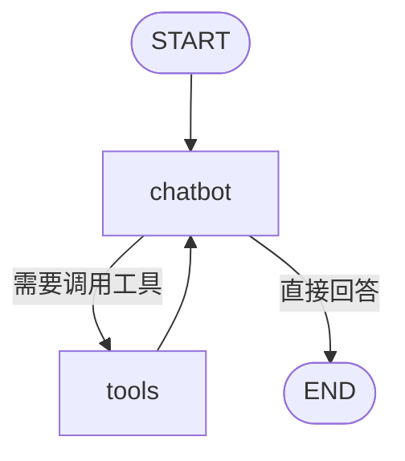

## 什么是 LangGraph

[LangGraph](https://langchain-ai.github.io/langgraph/) 是 LangChain 官方推出的库，用来构建**有状态（stateful）、多步骤**的 LLM 应用，比如 Agent、多轮工具调用、多角色协作系统。

和普通的链式调用（Chain）相比，LangGraph 把整个应用建模成一张**图（Graph）**：节点负责执行具体逻辑，边负责决定下一步流向哪个节点，状态则在图的执行过程中不断被更新和传递。这种模型天然适合表达"循环""分支""条件判断"等复杂控制流，而这些恰恰是纯链式结构很难优雅表达的。

---

## 核心概念

### 状态（State）

State 是贯穿整张图的共享数据结构，通常用 `TypedDict` 或 `pydantic.BaseModel` 定义。每个节点执行完之后，返回的是"对状态的增量更新"，LangGraph 会按照定义的 reducer（归约函数）把更新合并回全局状态。

```python
from typing import TypedDict, Annotated
from langgraph.graph.message import add_messages

class State(TypedDict):
    messages: Annotated[list, add_messages]  # 用 add_messages 追加而不是覆盖
```

- 不指定 `Annotated` 时，字段默认是**覆盖**更新
- `add_messages` 是内置的 reducer，会自动按 message id 去重/追加，常用于聊天记录

### 节点（Node）

Node 就是一个普通的函数（或 `Runnable`），接收当前 State，返回要更新的字段：

```python
def chatbot(state: State):
    response = llm.invoke(state["messages"])
    return {"messages": [response]}
```

### 边（Edge）

边决定了节点之间的执行顺序，分为两种：

- **普通边**：`graph.add_edge(A, B)`，A 执行完必然走到 B
- **条件边**：`graph.add_conditional_edges(A, router_fn, {"tool": "tools", "end": END})`，根据 `router_fn` 的返回值决定走向哪个分支

> **注意**：`router_fn`（常叫 `router` / `route_xxx`）**不是节点**，它是条件边里的"判断函数"——只接收 State、返回一个字符串（分支名），由 LangGraph 据此选择下一条边。它不写状态、不执行业务逻辑，因此不要把它和 Node 混淆。

配合 `START` / `END` 两个特殊节点，表示图的入口和出口。

> **一句话助记**：
> - **Node**：做什么（执行具体逻辑）
> - **Router**：去哪儿（判断下一步走向哪个分支）
> - **Edge**：怎么连接（把节点按顺序/条件串起来）
> - **State**：携带什么数据（贯穿全图、在各节点间传递更新）

### `add_conditional_edges` 参数拆解

```python
graph.add_conditional_edges(
    START,
    router1,
    {
        "add": "add_node",
        "subtract": "subtract_node"
    }
)
```

它可以用一句自然语言翻译为：

> 从 `START` 出发，调用 `router1` 检查当前 state，根据 `router1` 的返回值，选择 `add_node` 或 `subtract_node`。

三个参数分别是：

```python
graph.add_conditional_edges(
    从哪里开始判断,      # 通常是某个节点名或 START
    用哪个函数判断,      # router_fn，接收 State 返回分支名
    判断结果对应哪个节点  # 分支名 -> 节点名 的映射
)
```

### 状态图（StateGraph）

`StateGraph` 是构建图的入口类，典型流程是：**定义 State → 添加节点 → 添加边 → compile()**。

```python
from langgraph.graph import StateGraph, START, END

graph_builder = StateGraph(State)
graph_builder.add_node("chatbot", chatbot)
graph_builder.add_node("tools", tool_node)

graph_builder.add_edge(START, "chatbot")
graph_builder.add_conditional_edges("chatbot", route_tools, {"tools": "tools", END: END})
graph_builder.add_edge("tools", "chatbot")

graph = graph_builder.compile()
```

`compile()` 之后得到的 `graph` 本身也是一个 `Runnable`，可以直接 `.invoke()` / `.stream()`。



### Runnable

`Runnable` 是 LangChain 生态里统一的执行接口，几乎所有组件（LLM、Prompt、Chain、编译后的 Graph）都实现了它，核心方法是：

| 方法 | 作用 |
|------|------|
| `invoke()` | 同步执行一次 |
| `ainvoke()` | 异步执行一次 |
| `stream()` | 流式返回中间结果 |
| `batch()` | 批量执行 |

正因为编译后的 Graph 也是 `Runnable`，多个 Graph 可以像普通 Chain 一样嵌套组合，或者被封装成一个 Node 塞进更大的图里。

---

## Messages

LangGraph/LangChain 用一组 Message 类型来表示对话历史，每种角色对应一个类：

### SystemMessage

系统提示词，用来设定模型的角色、行为规范，通常放在消息列表最前面。

### HumanMessage

用户输入的消息。

### AIMessage

模型生成的回复。当模型决定调用工具时，会在 `tool_calls` 字段里携带工具名和参数，而不是直接返回文本：

```python
AIMessage(content="", tool_calls=[{"name": "search", "args": {"query": "天气"}, "id": "call_1"}])
```

### ToolMessage

工具执行完成后的返回结果，需要携带对应的 `tool_call_id`，与触发它的 `AIMessage.tool_calls` 一一对应，模型才能正确关联"这是哪次调用的结果"。

### FunctionMessage（已废弃）

OpenAI 早期 function-calling 时代的消息类型，现已被 `ToolMessage` + `AIMessage.tool_calls` 取代，新代码不再需要使用。

### 消息流转示意

在一次典型的 Agent 工具调用中，消息按以下顺序流转：

```
SystemMessage
"你应该怎么做"
        ↓
HumanMessage
"用户要你做什么"
        ↓
AIMessage
"模型回答，或者请求调用工具"
        ↓
ToolMessage
"工具实际返回了什么"
        ↓
AIMessage
"模型基于工具结果形成最终答案"
```

这就是 LangGraph 中 `State.messages` 列表里实际存放的内容——每一步对话/工具调用都对应一条 Message，按时间顺序追加，模型在生成下一条消息时会看到之前所有的消息。

---

## 工具（Tool）与 ToolNode

Tool 是模型可以调用的外部能力（搜索、计算、查数据库等），通常用 `@tool` 装饰器定义：

```python
from langchain_core.tools import tool

@tool
def search(query: str) -> str:
    """根据关键词搜索信息"""
    return f"关于 {query} 的搜索结果..."
```

把工具列表绑定给模型（`llm.bind_tools([search])`）后，模型在需要时会返回带 `tool_calls` 的 `AIMessage`。LangGraph 提供了现成的 `ToolNode`，负责执行这些 `tool_calls` 并把结果包装成 `ToolMessage` 写回 State：

```python
from langgraph.prebuilt import ToolNode

tool_node = ToolNode([search])
```

---

## 持久化与记忆（Checkpointer）

LangGraph 支持在每一步之后自动保存状态快照（checkpoint），从而实现：

- **跨轮对话记忆**：同一个 `thread_id` 下再次调用时，自动带上历史状态
- **中断与恢复**：长任务可以在某个节点暂停（`interrupt`），等待人工确认后再继续
- **时间旅行**：回溯到某个历史 checkpoint 重新执行

最简单的方式是用内存版 `MemorySaver`：

```python
from langgraph.checkpoint.memory import MemorySaver

graph = graph_builder.compile(checkpointer=MemorySaver())
graph.invoke({"messages": [...]}, config={"configurable": {"thread_id": "user-1"}})
```

生产环境可以换成 `SqliteSaver`、`PostgresSaver` 等持久化实现。

---

## 小结

LangGraph 用"状态 + 节点 + 边"的图模型，把 Agent 的控制流显式地画了出来，比隐藏在 Chain 内部的循环逻辑更直观、更易调试。核心要记住的几点：

1. State 定义共享数据结构，reducer 决定更新方式（覆盖 or 追加）
2. Node 是纯函数，读 State、写 State
3. 条件边负责实现分支/循环，是 Agent 能"思考下一步做什么"的关键
4. 编译后的 Graph 本身也是 Runnable，可以组合、可以流式执行
5. Checkpointer 让图具备记忆、可中断、可回放的能力


